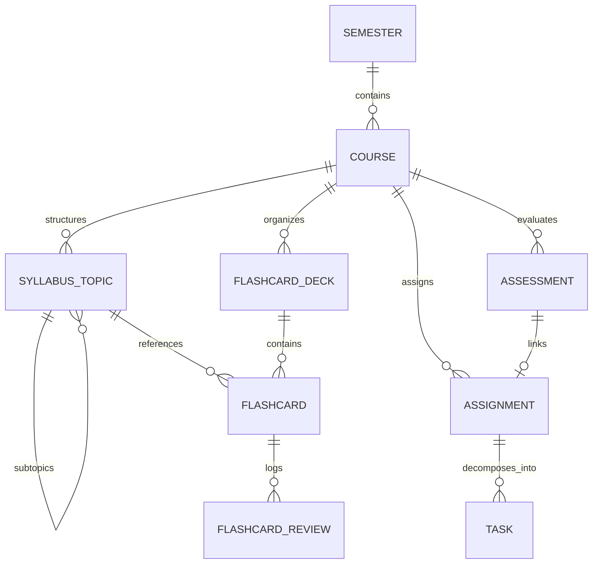

# Planrova 2.0 — Academic & Course Intelligence Domain

**Author:** Principal Software Architect, Senior Full-Stack Engineer, QA Lead  
**Date:** 2026-11-14  
**Document:** `docs/ACADEMIC_DOMAIN.md`

---

## 1. Architectural Vision

Planrova 2.0 transforms fragmented student workflows (courses, syllabi, lecture notes, exam prep, flashcards, grades) into a mathematically unified academic intelligence system.

All core logic resides in `shared/domain/academic/`, completely decoupled from DOM or mobile UI components:
$$\text{Semester} \longrightarrow \text{Course} \longrightarrow \text{Syllabus} \longrightarrow \text{Topic} \longrightarrow \text{Assignment} \longrightarrow \text{Task} \longrightarrow \text{Schedule} \longrightarrow \text{Flashcards} \longrightarrow \text{GPA}$$

---

## 2. Course Workspaces & Two-Way Syllabus Tree

### 2.1 Course Entity
Encapsulates course title, institutional course code (e.g. `CS 201`), credits (e.g. `4.0`), grading scale override, and calendar accent color.

### 2.2 Hierarchical Syllabus Completion Cascading
Syllabus topics form an $N$-ary tree (`parentTopicId`):
1. **Downwards Cascade:** Marking a parent unit complete automatically marks all descendant subtopics complete.
2. **Upwards Cascade:** Marking all child subtopics complete automatically advances the parent unit to complete. If any child is incomplete, the parent is marked incomplete.
3. **Progress Rollup:** Unit completion percentage is computed dynamically from estimated study minutes across completed topics.

---

## 3. Weighted Grading Engine & What-If Simulator

The grading engine ([`grading.engine.js`](file:///home/tanmay/Videos/planrova/shared/domain/academic/grading.engine.js)) ensures precision gradebook calculations across diverse institutional schemes:

### 3.1 Weight Validation & Allocation
Computes $\sum w_i$ across non-excused assessments:
- `complete`: Total weight is exactly 100%.
- `underweight`: Total weight < 100%, reporting unallocated percentage.
- `overweight`: Total weight > 100%, reporting over-allocation error.

### 3.2 Drop Lowest Policy
Instructors often employ policies such as "drop lowest 2 quiz scores":
1. Filters assessments by category (e.g. `type: 'quiz'`).
2. Computes earned ratios $\frac{\text{obtainedMarks}}{\text{totalMarks}}$.
3. Identifies the lowest $K$ scores and marks them with `isDropped: true`.
4. Excludes dropped items from earned quality points and completed weight totals.

### 3.3 What-If Assessment Target Simulator
Calculates required score on remaining assignments to achieve a target final grade:
$$\text{PointsNeeded} = \text{TargetPercentage} - \text{CompletedContribution}$$
$$\text{RequiredPercentage} = \frac{\text{PointsNeeded}}{\text{RemainingWeight}} \times 100$$
- If $\text{RequiredPercentage} \le 0$: Target is guaranteed with current marks.
- If $0 < \text{RequiredPercentage} \le 100$: Target is mathematically achievable.
- If $\text{RequiredPercentage} > 100$: Target is impossible; returns maximum achievable grade.

---

## 4. GPA Calculation & Multi-Semester Target Simulator

The GPA engine ([`gpa.engine.js`](file:///home/tanmay/Videos/planrova/shared/domain/academic/gpa.engine.js)) supports US 4.0, 10-Point International, and Percentage scales:

### 4.1 Semester GPA (SGPA) & Cumulative GPA (CGPA)
$$\text{SGPA} = \frac{\sum_{i=1}^N \left( \text{Credits}_i \times \text{GradePoints}_i \right)}{\sum_{i=1}^N \text{Credits}_i}, \qquad \text{CGPA} = \frac{\sum_{j=1}^M \left( \text{Credits}_j \times \text{SGPA}_j \right)}{\sum_{j=1}^M \text{Credits}_j}$$

### 4.2 Multi-Semester Target Simulator
Calculates required uniform SGPA across remaining semesters to graduate with a desired target CGPA:
$$\text{RequiredQP} = (\text{TargetCGPA} \times \text{TotalCredits}) - (\text{CurrentCGPA} \times \text{CompletedCredits})$$
$$\text{RequiredSGPA} = \frac{\text{RequiredQP}}{\text{UpcomingCredits}}$$

---

## 5. Assignment Dependency DAG & Critical Path Engine

The dependency engine ([`assignment-dependency.js`](file:///home/tanmay/Videos/planrova/shared/domain/academic/assignment-dependency.js)) treats assignments as vertices in a Directed Acyclic Graph (DAG):

1. **3-Color DFS Cycle Detection:** White (0 = unvisited), Gray (1 = visiting), Black (2 = visited). Gray neighbor detection flags circular dependencies and reconstructs the cyclic loop.
2. **Kahn's Topological Sort:** Generates an ordered execution sequence ensuring prerequisites strictly precede dependent work.
3. **Critical Path Analysis:** Dynamic programming across topologically sorted assignments identifies the bottleneck sequence of work determining minimum total completion time:
   $$\text{Duration}(u) = \text{EstimatedMinutes}(u) + \max_{v \in \text{Prerequisites}(u)} \text{Duration}(v)$$

---

## 6. Intelligent Spaced Repetition (Leitner 5-Box)

The spaced repetition engine ([`spaced-repetition.engine.js`](file:///home/tanmay/Videos/planrova/shared/domain/academic/spaced-repetition.engine.js)) powers flashcard mastery:

| Box | Interval | On `Again` | On `Hard` | On `Good` | On `Easy` |
| :---: | :---: | :---: | :---: | :---: | :---: |
| **Box 1** | 1 day | Reset to Box 1 | Stay in Box 1 | Advance to Box 2 | Leap to Box 3 |
| **Box 2** | 2 days | Reset to Box 1 | Stay in Box 2 | Advance to Box 3 | Leap to Box 4 |
| **Box 3** | 4 days | Reset to Box 1 | Stay in Box 3 | Advance to Box 4 | Leap to Box 5 |
| **Box 4** | 7 days | Reset to Box 1 | Stay in Box 4 | Advance to Box 5 | Leap to Box 5 |
| **Box 5** | 14 days | Reset to Box 1 | Stay in Box 5 | Stay in Box 5 | Stay in Box 5 |

Reviews generate immutable logs (`reviewRecord`) with timestamp, rating, box transitions, and interval days for retention analytics.

