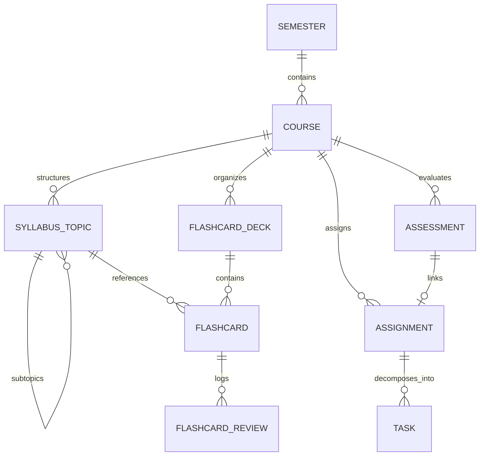

# Academic & Professional Workspaces — Domain Model Architecture

## 1. Overview & Architectural Vision
Planrova 2.0 Academic Workspaces transform fragmented student activities (courses, lecture notes, deadlines, flashcards, exams) into a unified, mathematically coherent Personal Life Operating System.

The fundamental design tenet is:
$$\text{Semester} \longrightarrow \text{Course} \longrightarrow \text{Syllabus} \longrightarrow \text{Topic} \longrightarrow \text{Assignment} \longrightarrow \text{Task} \longrightarrow \text{Schedule} \longrightarrow \text{Flashcards} \longrightarrow \text{GPA}$$

All core domain logic is housed inside `shared/domain/academic/`, completely decoupled from DOM manipulation, React Native UI components, or vendor database clients.

---

## 2. Entity Schemas & Relationships

### 2.1 Semester (`Semester`)
- `id`: Unique identifier (string).
- `name` / `title`: Academic semester name (e.g. "Fall 2026").
- `academicYear`: String identifier (e.g. "2026-2027").
- `term`: Term designation ("Fall", "Spring", "Summer", "Winter").
- `startDate` / `endDate`: Bounding calendar dates (`YYYY-MM-DD`).
- `gradingScaleId`: Active grading scale reference (`letter_4_0`, `points_10`, `percentage_100`).
- `status`: Lifecycle state (`upcoming`, `active`, `completed`, `archived`).
- `targetSGPA`: User-defined GPA goal for the semester (nullable).
- `actualSGPA`: Derived final GPA for completed semester (nullable).

### 2.2 Course (`Course`)
- `id`: Unique identifier.
- `semesterId`: Parent semester foreign key.
- `name` / `title`: Course title (e.g. "Data Structures and Algorithms").
- `courseCode`: Institutional identifier (e.g. "CS 201").
- `credits`: Academic credit weighting (positive number, e.g. 4.0).
- `gradingScaleId`: Course-specific grading scale override.
- `color`: UI hex accent for calendar and timetable rendering.
- `status`: Lifecycle state (`enrolled`, `active`, `completed`, `dropped`, `archived`).

### 2.3 Syllabus Topic (`Topic`)
- `id`: Unique identifier.
- `courseId`: Parent course foreign key.
- `parentTopicId`: Hierarchical parent topic/module ID (nullable for root units).
- `title`: Conceptual unit title.
- `order`: Integer sequence within unit.
- `estimatedMinutes`: Estimated deep focus study time required.
- `masteryLevel`: Progressive mastery state (`unstarted`, `learning`, `mastered`).
- `completed`: Boolean completion flag with two-way hierarchical cascading.
- `linkedNoteIds`: Array of canonical `Note` references.
- `linkedTaskIds`: Array of canonical `Task` references.

### 2.4 Assessment (`Assessment`)
- `id`: Unique identifier.
- `courseId`: Parent course foreign key.
- `title`: Assessment title (e.g. "Midterm Exam").
- `type`: Category (`assignment`, `quiz`, `midterm`, `final`, `practical`, `project`, `presentation`).
- `status`: Standing state (`pending`, `submitted`, `graded`, `excused`).
- `totalMarks`: Maximum attainable score (> 0).
- `obtainedMarks`: Earned score ($0 \le \text{obtainedMarks} \le \text{totalMarks}$).
- `weightPercentage`: Percentage contribution to course grade ($0 \le w \le 100$).
- `dueDate` / `examDate`: Scheduled execution date (`YYYY-MM-DD`).
- `startTime` / `durationMinutes`: Optional scheduling bounds.

### 2.5 Assignment (`Assignment`)
- `id`: Unique identifier.
- `courseId`: Parent course foreign key.
- `title`: Deliverable title.
- `priority`: Urgency rank (`low`, `medium`, `high`, `urgent`).
- `status`: Execution state (`not_started`, `in_progress`, `blocked`, `completed`).
- `estimatedMinutes` / `actualMinutes`: Time expenditure tracking.
- `dependencyIds`: Array of prerequisite Assignment IDs forming a Directed Acyclic Graph (DAG).
- `linkedTaskIds`: Array of canonical Task entities decomposed from this deliverable.
- `assessmentId`: Optional linked assessment record.

### 2.6 Flashcard & Deck (`Deck`, `Flashcard`, `FlashcardReview`)
- Implements the Leitner 5-box spaced repetition algorithm:
  - Box 1: 1-day interval
  - Box 2: 2-day interval
  - Box 3: 4-day interval
  - Box 4: 7-day interval
  - Box 5: 14-day interval
- Reviews generate timestamped immutable logs for learning retention tracking.

