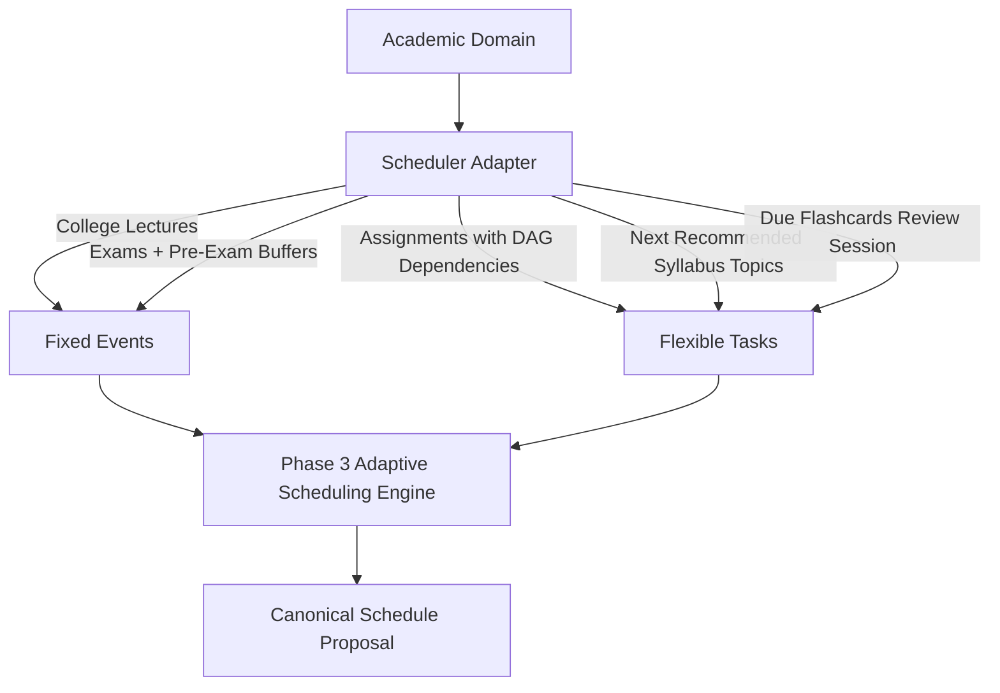

# Phase 3 Adaptive Planning Integration Architecture

## 1. Overview
Rather than constructing a redundant or competing scheduling algorithm, Phase 4 strictly leverages the Phase 3 Adaptive Planning Engine (`shared/domain/scheduling/`).

The integration adapter (`shared/domain/academic/academic-scheduler.adapter.js`) maps academic domain entities into canonical scheduling inputs:
1. **Fixed Commitments (`fixedEvents`)**
2. **Flexible Tasks (`tasks`)**
3. **Availability & Pre-Exam Buffers**

---

## 2. Transformation Pipeline

### 2.1 Fixed Commitments Mapping
- **College Lectures**: Timetable sessions for the target date are materialized with `isFixed: true` and `type: 'lecture'`.
- **Examinations**: Scheduled exams on the target date are mapped into fixed blocks.
- **Pre-Exam Buffer**: Automatically injects a configurable buffer block (default 30 min) preceding the exam start time.

### 2.2 Flexible Tasks Mapping
- **Assignments**: Active assignments map to flexible tasks with `estimatedMinutes`, `dueDate`, `priority`, and `dependencyIds`.
- **Syllabus Study**: Incomplete leaf topics recommended by the pedagogical engine map into study blocks (`duration = topic.estimatedMinutes`).
- **Spaced Repetition Review**: Due flashcards map into a high-priority review block ($\min(30, \lceil \frac{N \times 30}{60} \rceil)$ min).

---

## 3. Guarantees
1. **Zero Collision**: Flexible study blocks and assignments never collide with lectures, exams, or pre-exam buffers.
2. **Deterministic & Fast**: End-to-end schedule generation completes in <15ms.
3. **Workload Awareness**: Generates full utilization metrics and cognitive load scores for the academic day.

