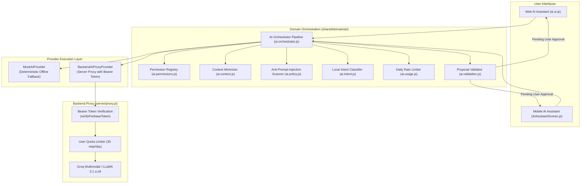

# Planrova 2.0 — Privacy-First Hybrid AI Assistant

**Author:** Principal Software Architect, AI Product Engineer, Distributed Systems Engineer  
**Date:** 2026-11-14  
**Document:** `docs/AI_ASSISTANT.md`

---

## 1. Architectural Vision & Foundational Invariants

Planrova 2.0 introduces AI assistance not as an opaque autonomous controller that directly mutates user state, but as a **supportive, privacy-first intelligence layer** anchored by three non-negotiable invariants:

1. **Deterministic Primacy**: Existing deterministic engines (Phase 3 Adaptive Scheduler, Phase 4 Academic DAG & Leitner, Phase 5 Finance Ledger & Habit Streaks) remain the sole authoritative engines for business logic, schedule proposals, and account balances.
2. **Proposal-and-Approval Workflow**: The AI assistant cannot directly write to database stores. Actionable insights (creating tasks, rescheduling study blocks, logging expenses) generate an immutable `AIActionProposal` requiring explicit human approval.
3. **Data Minimization & Opt-In Privacy**: AI is disabled by default (`enabled: false`). Context is strictly minimized and filtered by domain permissions. Sensitive categories (finance, wellbeing reflections, notes) default to `OFF`.

---

## 2. System Architecture



---

## 3. Provider Abstraction & Offline Fallback

Planrova's AI provider interface (`ai.provider.js`) defines two implementations:

### 3.1 MockAIProvider (Deterministic Local Offline Fallback)
- **Execution Mode:** Local-only, pure JavaScript, zero network calls.
- **Availability:** 100% available offline, in airplane mode, or during server outages.
- **Behavior:** Uses deterministic pattern engines to generate Daily Intelligence Briefings from local tasks and schedule data, answers queries, and creates structured action proposals.
- **Cost & Dependencies:** Zero API cost, zero external dependencies.

### 3.2 BackendAIProxyProvider (Server Proxy)
- **Execution Mode:** Routes requests through Planrova's lightweight Node proxy (`http://localhost:3001/api/ai/chat`).
- **Credential Protection:** Client devices never store or touch upstream API keys (`GROQ_API_KEY`).
- **Authentication:** Injects `Authorization: Bearer <firebase_id_token>` derived from authenticated user sessions.
- **Graceful Fallback:** If the proxy returns HTTP 503 (key not set), HTTP 401 (unauthenticated), HTTP 429 (quota exceeded), or network disconnect, it automatically falls back to `MockAIProvider` without disrupting user workflow.

---

## 4. Context Minimization & Privacy Model

The context engine ([`ai.context.js`](file:///home/tanmay/Videos/planrova/shared/domain/ai/ai.context.js)) builds minimal context:

1. **Opt-in Master Switch:** If `enabled === false`, `buildAIContext()` returns an empty string immediately.
2. **Category Toggles:** Tasks, Schedule, Academic, Notes, Finance, Habits, Wellbeing, Preferences.
3. **Sensitive Domains Default OFF:** Even when AI is enabled, Finance, Wellbeing, and Notes are toggled `false` by default.
4. **Field-Level Scrubbing:**
   - **Finance:** Bank account numbers and transaction amounts are scrubbed; only category names and bill titles are passed.
   - **Wellbeing:** Personal reflection notes and 1–5 emotional ratings are permanently scrubbed. Only habit streak counts and hydration percentages are passed.
5. **Character Bounds:** Context is truncated at 8,000 characters to prevent prompt injection overflow.

---

## 5. Action Proposal Workflow

The AI assistant follows an immutable proposal lifecycle:

1. **Generation:** When a user asks the assistant to plan their day or add a task, the assistant emits an `AIActionProposal`:
   ```javascript
   {
     id: "prop_1794649200_abc",
     userId: "user_123",
     type: "CREATE_TASK",
     payload: { title: "Complete CS 201 Lab Report", date: "2026-11-15", duration: 60 },
     status: "PENDING_APPROVAL",
     confidence: 0.95,
     explanation: "Suggested to complete prerequisite before Wednesday's lecture."
   }
   ```
2. **Validation (`ai.validation.js`):** Validates schema structure and verifies ownership (`expectedUserId === proposal.userId`).
3. **Human Approval:** UI renders an interactive Proposal Card with "Approve & Execute" or "Reject" buttons.
4. **Execution:** Upon approval, the orchestrator dispatches the payload to the canonical domain engine (e.g. creating the task in the planner). AI code never mutates databases directly.

---

## 6. Daily Intelligence Briefing

The assistant can synthesize an automated morning briefing from authorized context:
- Today's top 3 urgent priority tasks.
- Scheduled fixed commitments (lectures, exams).
- Spaced repetition flashcards due today.
- Active habit streaks to maintain.
- Reconciled budget status (if authorized).

