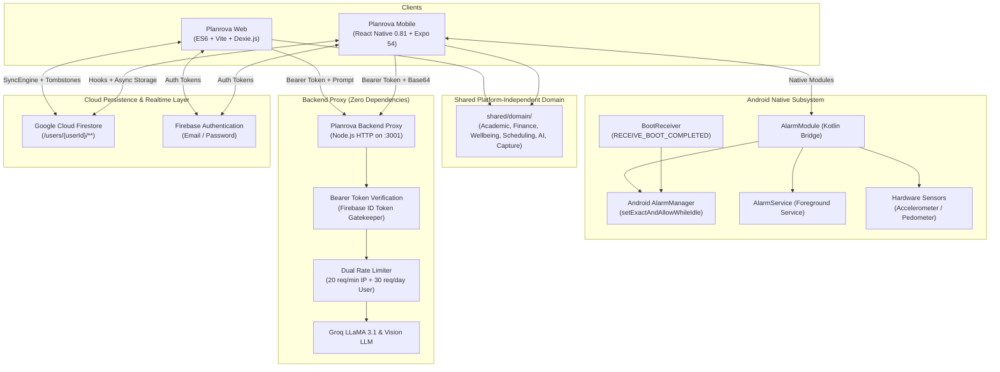

# Planrova 2.0 — System Architecture

**Author:** Principal Software Architect, Senior Full-Stack Engineer, Distributed Systems Engineer  
**Date:** 2026-11-14  
**Document:** `docs/ARCHITECTURE.md`

---

## 1. High-Level Architecture Overview

Planrova 2.0 uses a **distributed, local-first hybrid architecture** engineered for zero-latency interactions, multi-platform continuity, and absolute offline resilience.



---

## 2. Platform Breakdown

### 2.1 Web Client (Desktop / Laptop / Tablet)
- **Runtime:** Vanilla ES6 Modules (No React, Vue, or heavy framework overhead).
- **Bundler:** Vite 8.0.x with custom Rollup manual chunking.
- **Rendering Performance:** Direct DOM rendering guarantees sub-second initial paint, minimal battery drain, and $60\text{ FPS}$ fluid canvas animations.
- **PWA Capabilities:** Service worker caching, offline asset serving, and manifest for installable standalone desktop app.

### 2.2 Mobile Client (Android & iOS)
- **Runtime:** React Native 0.81.x with Expo SDK 54 (Managed + Continuous Native Generation).
- **Navigation:** React Navigation 7.x stack and tab navigators.
- **Screens:** `TasksScreen`, `CalendarScreen`, `PomodoroScreen`, `AcademicScreen`, `FinanceScreen`, `WellbeingScreen`, `AIAssistantScreen`.
- **Hardware Integration:** Android Kotlin native module utilizing `AlarmManager.setExactAndAllowWhileIdle` and foreground services for unkillable mission alarms.

### 2.3 Shared Domain Layer (`shared/domain/`)
All core computational logic is isolated into pure JavaScript modules completely decoupled from DOM manipulation, React Native UI components, or vendor databases:
- `shared/domain/academic/`: Course workspaces, syllabus trees, grading engines, GPA simulators, assignment DAGs, Leitner flashcard review.
- `shared/domain/finance/`: Integer minor units, account reconciliation, budget pacing, recurring subscriptions, savings goals.
- `shared/domain/wellbeing/`: Habit streaks, millilitre hydration tracking, ordered routines, reflection check-ins.
- `shared/domain/scheduling/`: Availability engine, candidate slot suitability scoring, workload modeling, snapshot freshness hashing.
- `shared/domain/ai/`: Opt-in permission engine, context minimization, anti-prompt injection, proposal dispatcher, local mock & proxy providers.
- `shared/domain/capture/`: Universal Quick Capture natural language parser and intent classifier.

### 2.4 Backend Proxy (`server/proxy.js`)
A lightweight, zero-npm-dependency Node.js HTTP server running on port 3001:
- Isolates upstream AI credentials (`GROQ_API_KEY`) so secrets never touch client devices.
- Authenticates client calls via `verifyFirebaseToken()` using Firebase ID tokens.
- Enforces sliding-window rate limits: 20 requests per minute per IP, and 30 requests per 24 hours per verified user.
- Enforces payload bounds ($\le 5000$ chars prompt, $\le 8000$ chars context).

---

## 3. Data Flow & Three-Tier Caching Architecture

Planrova implements a three-tier local-first storage hierarchy:

```
[UI Reads / Writes]
       │
       ▼ (Sub-millisecond)
┌────────────────────────────────────────────────────────┐
│  Tier 1: In-Memory Cache (storage.js)                   │
│  - Synchronous JavaScript Map                          │
│  - O(1) zero-latency reads & writes                    │
└──────────────────────────┬─────────────────────────────┘
                           │
                           ▼ (Asynchronous IndexedDB)
┌────────────────────────────────────────────────────────┐
│  Tier 2: Durable Local Storage (Dexie.js IndexedDB)    │
│  - Persistent local database (PlanrovaLocalDB v1)      │
│  - Survives browser restarts & offline sessions        │
│  - Namespaced by userId (planrova_{domain}_{userId})   │
└──────────────────────────┬─────────────────────────────┘
                           │
                           ▼ (Background Synchronization)
┌────────────────────────────────────────────────────────┐
│  Tier 3: Cloud Firestore & Realtime Layer              │
│  - Replicated under /users/{userId}/**                 │
│  - Bidirectional sync with vector tombstones           │
│  - Last-Write-Wins (LWW) conflict resolution           │
└────────────────────────────────────────────────────────┘
```

---

## 4. Production Bundle Architecture & Code-Splitting

Production builds are optimized via Vite and Rollup manual chunking in `vite.config.js`:

```javascript
build: {
  chunkSizeWarningLimit: 600,
  rollupOptions: {
    output: {
      manualChunks(id) {
        if (id.includes('@firebase') || id.includes('firebase/')) {
          return 'vendor-firebase';
        }
      }
    }
  }
}
```

### Measured Production Chunks
| Asset / Chunk | Size | Gzip | Loading Mechanism |
| :--- | :--- | :--- | :--- |
| `dist/assets/index-*.js` | **139.16 kB** | 39.82 kB | Main entry application chunk |
| `dist/assets/vendor-firebase-*.js` | **411.91 kB** | 124.14 kB | Preloaded vendor chunk (`<link rel="modulepreload">`) |
| `dist/assets/database-*.js` | **95.78 kB** | 31.57 kB | Dexie IndexedDB sub-chunk |
| `dist/assets/academic.ui-*.js` | **40.75 kB** | 7.88 kB | Lazy-loaded on demand when entering Academic Workspace |
| `dist/assets/finance.ui-*.js` | **17.11 kB** | 4.13 kB | Lazy-loaded on demand when entering Finance Workspace |
| `dist/assets/wellbeing.ui-*.js` | **12.06 kB** | 3.46 kB | Lazy-loaded on demand when entering Wellbeing Workspace |
| `dist/assets/ai.ui-*.js` | **15.53 kB** | 4.46 kB | Lazy-loaded on demand when opening AI Assistant |

### Cold Load vs. Subsequent Load Network Transfer
- **Cold First Visit (Uncached):** Approximately **840 kB uncompressed** (~250 kB gzipped) is downloaded because Firebase Auth initializes on app boot.
- **Subsequent Visits (Cached):** The immutable 412 kB `vendor-firebase` chunk is served from browser cache. Application updates only require fetching the 139 kB entry chunk.
- **Workspace Isolation:** None of the heavy feature workspace bundles (`academic.ui`, `finance.ui`, `wellbeing.ui`, `ai.ui`) are loaded until the user explicitly navigates to them.
