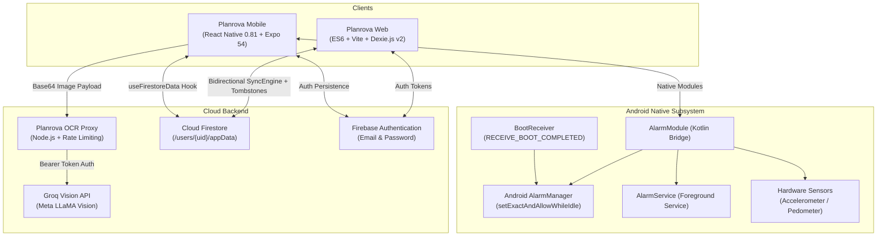

# Planrova 2.0 — System Architecture

## 1. High-Level Architecture Overview

Planrova uses a **distributed, local-first hybrid architecture** comprising:
1. **Desktop Web Application:** Built with Vanilla ES6 modules, Vite, and Dexie.js (IndexedDB). Zero virtual DOM overhead for high performance and low battery consumption.
2. **Mobile Companion (Android / iOS):** Built with React Native 0.81 and Expo SDK 54, integrating custom native Kotlin bridges for hardware-level alarm management.
3. **Backend OCR Proxy:** A zero-dependency Node.js HTTP/HTTPS server providing sliding-window rate limiting and secure credential isolation for Groq Multimodal Vision LLM requests.
4. **Cloud Persistence & Realtime Layer:** Google Cloud Firestore and Firebase Authentication for multi-device synchronization and public directory discovery.



---

## 2. Web Architecture

### Module Separation & Initialization
- **Entry Point:** [src/main.js](file:///home/tanmay/Videos/planrova/src/main.js) evaluates CSS variables, checks authentication state (`onAuthStateChanged`), loads memory cache from IndexedDB via `preloadCache()`, and initializes modular sub-systems in safe `try/catch` boundaries.
- **State Management:** Hybrid three-tier state architecture:
  1. *L1 (In-Memory Cache):* Fast, synchronous JavaScript `Map` inside [storage.js](file:///home/tanmay/Videos/planrova/src/utils/storage.js) guaranteeing $O(1)$ zero-latency UI reads.
  2. *L2 (Durable Local Storage):* IndexedDB managed by `Dexie.js` ([database.js](file:///home/tanmay/Videos/planrova/src/db/database.js)) for offline durability up to gigabytes of data.
  3. *L3 (Cloud Synchronization):* Asynchronous replication to Cloud Firestore via [syncEngine.js](file:///home/tanmay/Videos/planrova/src/db/syncEngine.js).
- **Event Bus:** Decoupled inter-module communication using custom DOM window events:
  - `planrova:data_changed`: Dispatched on local writes or cloud pulls.
  - `planrova:cloud_update`: Dispatched when Firestore pushes newer data.
  - `planrova:sync_status`: Dispatched on sync transitions (`idle`, `syncing`, `synced`, `error`, `offline`).

### PWA Offline Behavior & Service Worker
- **Service Worker:** [public/sw.js](file:///home/tanmay/Videos/planrova/public/sw.js) implements Cache-First strategy for static assets (`/`, `/index.html`, `/favicon.ico`, `/icons.svg`, `/site.webmanifest`).
- **Offline Fallback:** Navigation requests intercepted and served from `/index.html` cache when offline.

---

## 3. Android Native Architecture

### Expo & Kotlin Bridge Integration
- **React Native Framework:** React Native 0.81.5 with Expo 54 in Bare / Custom Native module mode.
- **AlarmModule (`AlarmModule.kt`):** Native module exposed to React Native via `@ReactMethod`:
  - `getAlarms()`: Reads scheduled alarms from `SharedPreferences`.
  - `saveAlarms(alarmsJson)`: Persists alarms and triggers background rescheduling.
  - `stopRinging()`: Halts active ringing audio and tears down `AlarmService`.
  - `snoozeAlarm(alarmId, snoozeMinutes)`: Reschedules exact alarm offset by snooze interval.
  - `checkPermissions()`: Verifies `SCHEDULE_EXACT_ALARM`, `POST_NOTIFICATIONS`, and battery optimization exclusions (`isIgnoringBatteryOptimizations`).

### Exact Alarms & Doze Mode Survival
- Uses `AlarmManager.setExactAndAllowWhileIdle()` to guarantee execution even when Android puts the device into deep Doze mode.
- `AlarmReceiver.kt` catches the pending intent, acquires a temporary partial `WakeLock`, and launches `AlarmService.kt` as an active foreground service (`foregroundServiceType="mediaPlayback"`).
- `AlarmActivity.kt` is launched with `showWhenLocked="true"` and `turnScreenOn="true"` to display mission challenges (math, steps, shake) over the lock screen.
- `BootReceiver.kt` registers for `android.intent.action.BOOT_COMPLETED` and `MY_PACKAGE_REPLACED` to re-register all exact alarms across system reboots without requiring user interaction.

---

## 4. Backend Architecture (OCR Vision Proxy)

- **Runtime:** Node.js HTTP/HTTPS server ([server/proxy.js](file:///home/tanmay/Videos/planrova/server/proxy.js)) operating on port 3001.
- **Authentication Isolation:** The Groq API key resides exclusively on the server in `.env`. Mobile and web clients forward only image payloads; credentials never touch client binaries.
- **Rate Limiting:** Built-in sliding-window limiter enforcing 20 scans per minute per client IP, returning standard `429 Too Many Requests` with `X-RateLimit-*` headers upon abuse.
- **Payload Validation:** Restricts request body size to 15MB, validates JSON schema and ensures non-empty prompt message arrays.

---

## 5. Database Architecture & Synchronization

### Dexie Schema Versions
```javascript
// Version 1 (Legacy)
localDB.version(1).stores({
  kv_store: 'id, sync_status, updated_at'
});

// Version 2 (Planrova 2.0 Hardened)
localDB.version(2).stores({
  kv_store: 'id, sync_status, updated_at, user_id, retry_count'
}).upgrade(tx => {
  return tx.table('kv_store').toCollection().modify(record => {
    if (!record.user_id) record.user_id = 'local';
    if (typeof record.retry_count !== 'number') record.retry_count = 0;
  });
});
```

### Conflict Resolution & Deletion Semantics
- **Single Values:** Last-Write-Wins (LWW) based on `updated_at` millisecond timestamp.
- **Collections (`tasks`, `habits`, `notes`, `expenses`, `brain_dump`):**
  - Unique ID indexing (`id` or `date`).
  - **Tombstones:** Deleted items maintain `deleted: true`. During cloud conflict merging, tombstones prevent deleted records from resurrecting when merged with older cloud snapshots.
  - **Completion Preservation:** If an item is marked `completed: true` in either local or cloud snapshot, completion status is retained.
- **Progression Metrics:**
  - `gamification`: Retains $\max(\text{local.level}, \text{cloud.level})$ and $\max(\text{local.xp}, \text{cloud.xp})$.
  - `focus_coins`: Retains $\max(\text{local.coins}, \text{cloud.coins})$.
  - `unlocked_seeds`: Computes set union $\text{local} \cup \text{cloud}$.

