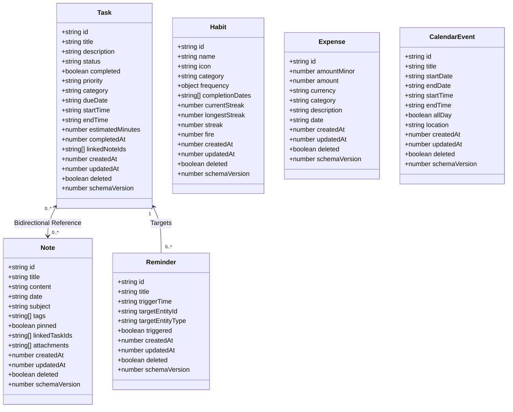

# Planrova 2.0 — Canonical Domain Model Specification

## 1. Executive Summary

Planrova 2.0 establishes a unified, shared canonical domain model across both the Web client (Vanilla ES6 modules + Dexie/IndexedDB) and the Mobile client (React Native + Expo SDK 54 + Cloud Firestore).

Prior to Phase 2, divergent domain representations caused state synchronization discrepancies—most notably in habit completion tracking (Web stored separate daily log keys with `streak`, while Mobile stored inline array objects with `fire`), task completion statuses (boolean `completed` vs categorical status), and one-sided note linking.

The Phase 2 Canonical Domain layer (`shared/domain/`) standardizes:
1. Canonical entity schemas, validation, and deterministic normalizers.
2. Bidirectional referential integrity between Notes and Tasks.
3. Single source of truth for Habit streak calculation based on immutable completion dates.
4. Monetary integrity utilizing integer minor units (`amountMinor` in paise/cents).
5. Seamless backward and forward compatibility with existing v1 records.

---

## 2. Canonical Entity Schemas

### 2.1 Task Entity
- **Source File:** [task.schema.js](file:///home/tanmay/Videos/planrova/shared/domain/entities/task.schema.js)
- **Primary Collection:** `tasks`

| Field | Type | Required | Canonical Allowed Values / Format | Description |
| :--- | :--- | :--- | :--- | :--- |
| `id` | `string` | Yes | Unique ID string (e.g. `t_1731574800000`) | Immutable primary key. |
| `title` | `string` | Yes | Non-empty string (trimmed) | Title of the task. |
| `description` | `string` | No | String (alias `desc` preserved) | Contextual details, links, or notes. |
| `status` | `string` | Yes | `todo`, `in_progress`, `completed`, `cancelled` | Canonical workflow status. |
| `completed` | `boolean` | Yes | `true` or `false` | Legacy convenience mirror (`status === 'completed'`). |
| `priority` | `string` | Yes | `low`, `medium`, `high`, `urgent` | Priority rating. Default: `medium`. |
| `category` | `string` | Yes | `study`, `work`, `personal`, `health`, `finance`, `other` | Categorization taxonomy. Default: `study`. |
| `dueDate` | `string` | Yes | `YYYY-MM-DD` (alias `date` preserved) | Scheduled date. |
| `startTime` | `string` | No | `HH:MM` (24h) | Scheduled start time. |
| `endTime` | `string` | No | `HH:MM` (24h) | Scheduled end time. |
| `estimatedMinutes` | `number` | No | Non-negative integer or `null` | Planned focus duration. |
| `completedAt` | `number` | No | Epoch millisecond timestamp or `null` | Completion record time. |
| `linkedNoteIds` | `string[]` | No | Array of unique Note IDs | Bidirectional references to linked notes. |
| `createdAt` | `number` | Yes | Epoch milliseconds | Creation timestamp. |
| `updatedAt` | `number` | Yes | Epoch milliseconds | Last mutation timestamp. |
| `deleted` | `boolean` | No | `true` or `false` | Soft-deletion tombstone. Default: `false`. |
| `schemaVersion` | `number` | Yes | `1` | Canonical schema version indicator. |

---

### 2.2 Note Entity
- **Source File:** [note.schema.js](file:///home/tanmay/Videos/planrova/shared/domain/entities/note.schema.js)
- **Primary Collection:** `notes`

| Field | Type | Required | Format / Allowed Values | Description |
| :--- | :--- | :--- | :--- | :--- |
| `id` | `string` | Yes | Unique string (e.g. `n_1731574800000`) | Immutable primary key. |
| `title` | `string` | Yes | String | Note subject/title. |
| `content` | `string` | Yes | String (HTML or plain text) | Markdown or rich body. |
| `date` | `string` | Yes | `YYYY-MM-DD` | Day association for timetable drawer. |
| `subject` | `string` | No | String (default `General`) | Academic or project classification. |
| `tags` | `string[]` | No | Array of strings | Subject or concept tags. |
| `pinned` | `boolean` | No | `true` or `false` | Pins note to top of day column in timetable. |
| `linkedTaskIds` | `string[]` | No | Array of Task IDs (alias `linkedTasks` preserved) | Bidirectional references to linked tasks. |
| `attachments` | `string[]` | No | Array of base64/URL image strings | Note visual attachments. |
| `createdAt` | `number` | Yes | Epoch milliseconds | Creation timestamp. |
| `updatedAt` | `number` | Yes | Epoch milliseconds | Last mutation timestamp. |
| `deleted` | `boolean` | No | `true` or `false` | Tombstone indicator. |
| `schemaVersion` | `number` | Yes | `1` | Schema version indicator. |

---

### 2.3 Habit Entity
- **Source File:** [habit.schema.js](file:///home/tanmay/Videos/planrova/shared/domain/entities/habit.schema.js)
- **Primary Collection:** `user_habits` (Web) / `habits` (Mobile / Firestore)

| Field | Type | Required | Format / Description |
| :--- | :--- | :--- | :--- |
| `id` | `string` | Yes | Unique habit identifier. |
| `name` | `string` | Yes | Habit label (e.g. `Read 20 pages`). |
| `icon` | `string` | Yes | Icon identifier (default `sparkles`). |
| `category` | `string` | No | Habit category (`health`, `study`, etc.). |
| `frequency` | `object` | Yes | `{ type: 'daily' \| 'weekly', days: number[] }`. |
| `completionDates` | `string[]` | Yes | **Single source of truth:** sorted array of unique `YYYY-MM-DD` strings. |
| `currentStreak` | `number` | Yes | Deterministically derived count of consecutive active days. |
| `longestStreak` | `number` | Yes | All-time highest streak count. |
| `streak` | `number` | Yes | Legacy Web compatibility mirror (`= currentStreak`). |
| `fire` | `number` | Yes | Legacy Mobile compatibility mirror (`= currentStreak`). |
| `logs` | `object[]` | Yes | Legacy Mobile compatibility mirror (`[{ date: 'YYYY-MM-DD' }]`). |
| `createdAt` | `number` | Yes | Creation timestamp. |
| `updatedAt` | `number` | Yes | Last update timestamp. |
| `deleted` | `boolean` | No | Tombstone indicator. |
| `schemaVersion` | `number` | Yes | `1` |

#### Deterministic Streak Calculation Algorithm
Given a habit's `completionDates` array:
1. Sort dates in ascending order and remove duplicates.
2. Evaluate consecutive day continuity working backward from today (or yesterday if today is not yet logged).
3. If neither today nor yesterday is present in `completionDates`, `currentStreak` is immediately `0`.
4. Iterate through consecutive day gaps: if $date_{i} - date_{i-1} = 1 \text{ day}$, streak increases; any gap $> 1$ terminates the streak sequence.
5. `longestStreak` is computed across the entire historical sequence.

---

### 2.4 Expense Entity
- **Source File:** [expense.schema.js](file:///home/tanmay/Videos/planrova/shared/domain/entities/expense.schema.js)
- **Primary Collection:** `expenses`

| Field | Type | Required | Format / Description |
| :--- | :--- | :--- | :--- |
| `id` | `string` | Yes | Unique expense identifier. |
| `amountMinor` | `number` | Yes | **Monetary integer in minor units (paise/cents).** Prevents floating point errors. |
| `amount` | `number` | Yes | Major currency units (`amountMinor / 100`) for display. |
| `currency` | `string` | Yes | ISO 4217 currency code (`INR`, `USD`, `EUR`, `GBP`). Default: `INR`. |
| `category` | `string` | Yes | Taxonomy: `Food`, `Transport`, `Study`, `Housing`, `Entertainment`, `Health`, `Other`. |
| `description` | `string` | Yes | Expense memo or merchant name. |
| `date` | `string` | Yes | `YYYY-MM-DD` transaction date. |
| `schemaVersion` | `number` | Yes | `1` |

---

### 2.5 Reminder Entity
- **Source File:** [reminder.schema.js](file:///home/tanmay/Videos/planrova/shared/domain/entities/reminder.schema.js)

| Field | Type | Required | Format / Description |
| :--- | :--- | :--- | :--- |
| `id` | `string` | Yes | Unique reminder identifier. |
| `title` | `string` | Yes | Reminder alert text. |
| `triggerTime` | `string` | Yes | ISO 8601 string or epoch milliseconds timestamp. |
| `targetEntityId` | `string` | No | ID of associated Task or Habit (if linked). |
| `targetEntityType` | `string` | No | `task`, `habit`, `calendar_event`, `none`. |
| `triggered` | `boolean` | Yes | `true` if alarm has fired. |
| `schemaVersion` | `number` | Yes | `1` |

---

### 2.6 Calendar Event Entity
- **Source File:** [calendar-event.schema.js](file:///home/tanmay/Videos/planrova/shared/domain/entities/calendar-event.schema.js)

| Field | Type | Required | Format / Description |
| :--- | :--- | :--- | :--- |
| `id` | `string` | Yes | Unique calendar event identifier. |
| `title` | `string` | Yes | Event name or lecture title. |
| `startDate` | `string` | Yes | `YYYY-MM-DD` |
| `endDate` | `string` | Yes | `YYYY-MM-DD` |
| `startTime` | `string` | No | `HH:MM` |
| `endTime` | `string` | No | `HH:MM` |
| `allDay` | `boolean` | No | `true` if day-long event. |
| `location` | `string` | No | Room number, hall, or URL. |
| `schemaVersion` | `number` | Yes | `1` |

---

## 3. Bidirectional Note-Task Relationship Architecture

- **Implementation:** [entity-links.js](file:///home/tanmay/Videos/planrova/shared/domain/relationships/entity-links.js)
- **Unit Tests:** [relationships.test.js](file:///home/tanmay/Videos/planrova/tests/relationships.test.js)

### 3.1 Contract & Invariants
1. **Symmetric Referencing:** When Note $N$ links to Task $T$, $N.linkedTaskIds$ contains $T.id$ AND $T.linkedNoteIds$ contains $N.id$.
2. **Set Deduplication:** Neither entity contains duplicate IDs in its relationship array.
3. **Soft-Delete Cascade Protection:** When either entity is deleted, `cleanupDeletedEntityLinks(deletedType, deletedId, entities)` cleans up all references across the surviving collection.
4. **Legacy Compatibility:** For backwards compatibility with v1 web notes, `note.linkedTasks` is kept in sync with `note.linkedTaskIds`.

### 3.2 Web UI Integration
- **Notes Drawer:** Displays `#note-linked-tasks-section` with interactive task completion checkboxes, unlink buttons, and direct "+ Add Task from Note" input.
- **Task Edit Modal:** Displays `#task-linked-notes-row` with active note chips, unlink buttons, and dropdown picker to link existing unlinked notes.
- **Timetable Grid Card:** Displays a paperclip link badge (`.task-linked-note-indicator`) with a direct click listener opening the linked note drawer.

