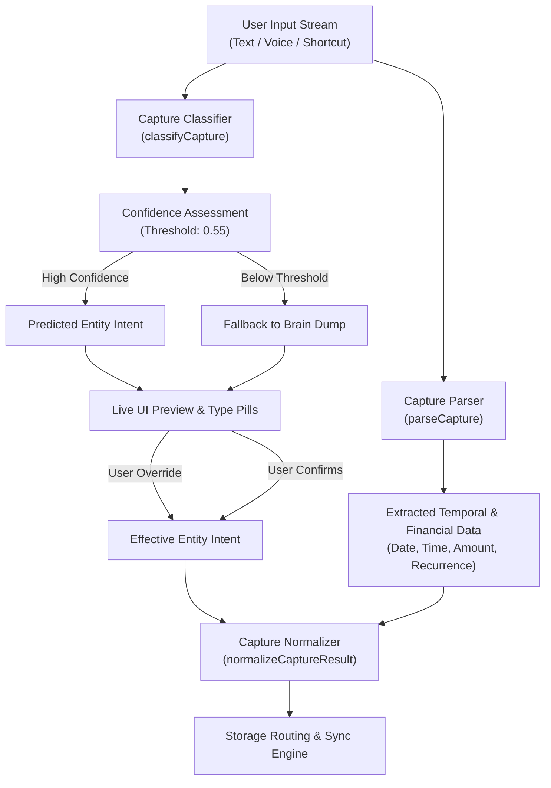

# Planrova 2.0 — Canonical Domain Models & Universal Capture

**Author:** Principal Software Architect & Database Architect  
**Date:** 2026-11-14  
**Document:** `docs/DOMAIN_MODELS.md`

---

## 1. Architectural Mission

Planrova 2.0 establishes canonical entity models across all platforms (Web and React Native Mobile). All domain logic is located under `shared/domain/` with zero UI or database dependencies.

The core principle:
> **"Capture anything once. Organize it intelligently. Manage your entire life from one system."**

---

## 2. Canonical Entities & Schemas

### 2.1 Task (`shared/domain/schemas/task.schema.js`)
Represents an actionable to-do item:
- `id`: String identifier (`task_...`).
- `userId`: Owner user identifier.
- `title`: Short task description.
- `date`: Calendar date (`YYYY-MM-DD`).
- `completed`: Boolean completion flag.
- `priority`: Urgency level (`'urgent' | 'high' | 'medium' | 'low'`).
- `duration`: Estimated duration in minutes (positive integer, default 30).
- `courseId`: Optional linked academic Course ID.
- `assignmentId`: Optional parent assignment deliverable ID.
- `topicId`: Optional linked syllabus topic ID.
- `splitSourceTaskId`: Pointer to parent task if split across schedule blocks.
- `isSplit`: Boolean flag indicating multi-block scheduling.

### 2.2 CalendarEvent (`shared/domain/schemas/calendar.schema.js`)
Represents a fixed time commitment:
- `id`: Unique identifier (`evt_...`).
- `userId`: Owner ID.
- `title`: Event name.
- `date`: Calendar date (`YYYY-MM-DD`).
- `startTime`: 24-hour start time (`HH:MM`).
- `endTime`: 24-hour end time (`HH:MM`).
- `isAllDay`: Boolean flag.
- `eventType`: `'lecture' | 'exam' | 'personal' | 'meeting' | 'routine' | 'study_session'`.
- `isFixed`: Boolean flag (true = immovable block for scheduling engine).

### 2.3 Habit (`shared/domain/wellbeing/habit.engine.js`)
Represents a recurring behavioral routine:
- `id`: Unique identifier (`habit_...`).
- `name`: Habit title.
- `frequency`: `{ type: 'daily' | 'weekdays' | 'weekly' | 'custom', days: number[] }`.
- `completionDates`: Authoritative array of `YYYY-MM-DD` strings.
- `currentStreak`: Active consecutive streak count.
- `longestStreak`: All-time record streak count.
- `isPaused`: Boolean flag pausing habit without streak penalty.

### 2.4 Note (`shared/domain/schemas/note.schema.js`)
Represents a knowledge base document:
- `id`: Unique identifier (`note_...`).
- `title`: Document heading.
- `content`: Markdown text content with slash block notation.
- `folder`: Category grouping or notebook name.
- `tags`: Array of string tags.
- `isPinned`: Boolean favorite flag.
- `linkedEntityIds`: References to linked courses, topics, or assignments.

### 2.5 Expense (`shared/domain/finance/finance.schemas.js`)
Represents a financial outlay:
- `id`: Unique identifier (`txn_...`).
- `accountId`: Primary account ID.
- `amountMinor`: Positive integer minor currency units (e.g. Paise, Cents).
- `currency`: ISO-4217 currency code (`INR`, `USD`, `EUR`).
- `categoryId`: Spending category reference.
- `transactionDate`: Local calendar date (`YYYY-MM-DD`).
- `paymentMethod`: `'cash' | 'card' | 'upi' | 'bank' | 'other'`.

### 2.6 Reminder & Alarm
Represents a temporal alert:
- `id`: Unique identifier (`rem_...`).
- `title`: Alert text.
- `dueTimestamp`: Epoch millisecond trigger time.
- `missionType`: Native dismiss challenge (`'none' | 'math' | 'steps' | 'shake' | 'typing'`).

---

## 3. Universal Quick Capture System

### 3.1 Intent Priority Cascade
The capture classifier ([`shared/domain/capture/capture.classifier.js`](file:///home/tanmay/Videos/planrova/shared/domain/capture/capture.classifier.js)) evaluates raw text through an ordered rule-based cascade:

1. **Expense Intent (Priority 1):**
   - Currency Symbols: `₹`, `$`, `€`, `£`, `rs.`, `rs`, `rupees`, `paise`.
   - Action Verbs: `spent`, `spend`, `bought`, `buy`, `paid`, `cost`, `expense`, `kharcha`.
2. **Habit Intent (Priority 2):**
   - Repetition Keywords: `every day`, `daily`, `every morning`, `every week`, `roz`, `harr din`.
3. **Calendar Event Intent (Priority 3):**
   - Fixed Appointments: `meeting`, `lecture`, `flight`, `call`, `class`, `workshop`, `interview`.
4. **Reminder Intent (Priority 4):**
   - Explicit Triggers: `remind me`, `alarm`, `wake me`, `set alarm`.
5. **Task Intent (Priority 5):**
   - Action Keywords: `submit`, `finish`, `do`, `prepare`, `read`, `write`, `complete`.
6. **Note Intent (Priority 6):**
   - Knowledge Capture: `idea:`, `note:`, `remember:`, `summary:`.
7. **Brain Dump (Fallback):**
   - Inputs below the $0.55$ confidence threshold route safely to the unstructured Brain Dump inbox.

### 3.2 Temporal & Multilingual Parser (`capture.parser.js`)
- **Relative Dates:** `today`, `tomorrow`, `tonight`, `next monday`, `in 3 days`.
- **Hindi / Hinglish Cues:** `kal` (tomorrow), `parso` (day after tomorrow), `aaj` (today), `subah` (morning), `shaam` (evening), `raat` (night).
- **Time Formats:** `at 5pm`, `17:30`, `in 2 hours`, `6:30 am`.
- **Multi-Task Splitting:** Automatically splits conjunctions (`and`, `then`, `aur`) into distinct task proposals.

