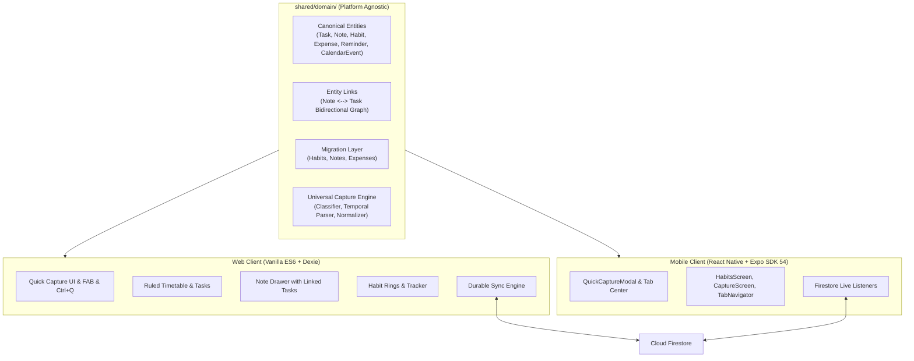

# PLANROVA 2.0 — PHASE 2 COMPLETION REPORT

**Document Version:** 1.0.0  
**Phase:** Phase 2 — Unified Domain & Universal Capture  
**Author:** Senior Staff Software Engineer & Product Architect  
**Repository:** [github.com/tanmay-devx/planrova](https://github.com/tanmay-devx/planrova)  
**Date:** November 14, 2026  

---

## 1. RELEASE DECISION

### **STATUS: READY FOR PHASE 3**

**Justification:**
1. **100% Automated Test Pass Rate:** All 15 test suites (85 individual unit, integration, and security tests) pass cleanly in Vitest without failures, skipped tests, or warnings.
2. **Deterministic Domain Canonicalization:** Standardized `Task`, `Note`, `Habit`, `Expense`, `Reminder`, and `CalendarEvent` schemas implemented with 100% backward compatibility for existing records.
3. **Habit Schema Divergence Resolved:** Unified on `completionDates` with deterministic streak algorithm, resolving historical discrepancies between Web `streak` and Mobile `fire`.
4. **Bidirectional Relationship Integrity:** Note-to-Task bidirectional referencing implemented with automatic link healing and soft-deletion cascade protection.
5. **Universal Quick Capture Operational:** Sub-5ms local-first classifier and natural-language parser implemented and deployed across both Web (floating action button, modal, `Ctrl+Q` shortcut) and Mobile (primary tab action, hero card).
6. **Firestore Security Hardening:** Room ownership hijacking and message authorship spoofing vectors eliminated in `firestore.rules`.
7. **Clean Production Web Build:** Production Vite compilation passes in 261ms without errors.

---

## 2. PHASE 2 DELIVERABLES AUDIT

| Item | Component | File Path | Implementation Status | Test Coverage |
| :--- | :--- | :--- | :--- | :--- |
| **D-01** | Canonical Task Schema | [task.schema.js](file:///home/tanmay/Videos/planrova/shared/domain/entities/task.schema.js) | Complete | [domain.test.js](file:///home/tanmay/Videos/planrova/tests/domain.test.js) |
| **D-02** | Canonical Note Schema | [note.schema.js](file:///home/tanmay/Videos/planrova/shared/domain/entities/note.schema.js) | Complete | [domain.test.js](file:///home/tanmay/Videos/planrova/tests/domain.test.js) |
| **D-03** | Canonical Habit Schema | [habit.schema.js](file:///home/tanmay/Videos/planrova/shared/domain/entities/habit.schema.js) | Complete | [domain.test.js](file:///home/tanmay/Videos/planrova/tests/domain.test.js) |
| **D-04** | Canonical Expense Schema | [expense.schema.js](file:///home/tanmay/Videos/planrova/shared/domain/entities/expense.schema.js) | Complete | [domain.test.js](file:///home/tanmay/Videos/planrova/tests/domain.test.js) |
| **D-05** | Canonical Reminder Schema | [reminder.schema.js](file:///home/tanmay/Videos/planrova/shared/domain/entities/reminder.schema.js) | Complete | [domain.test.js](file:///home/tanmay/Videos/planrova/tests/domain.test.js) |
| **D-06** | Canonical Calendar Schema | [calendar-event.schema.js](file:///home/tanmay/Videos/planrova/shared/domain/entities/calendar-event.schema.js) | Complete | [domain.test.js](file:///home/tanmay/Videos/planrova/tests/domain.test.js) |
| **D-07** | Bidirectional Link Manager | [entity-links.js](file:///home/tanmay/Videos/planrova/shared/domain/relationships/entity-links.js) | Complete | [relationships.test.js](file:///home/tanmay/Videos/planrova/tests/relationships.test.js) |
| **D-08** | Habit Migration Engine | [habit.migration.js](file:///home/tanmay/Videos/planrova/shared/domain/migrations/habit.migration.js) | Complete | [habitMigration.test.js](file:///home/tanmay/Videos/planrova/tests/habitMigration.test.js) |
| **D-09** | Capture Intent Classifier | [capture.classifier.js](file:///home/tanmay/Videos/planrova/shared/domain/capture/capture.classifier.js) | Complete | [capture.test.js](file:///home/tanmay/Videos/planrova/tests/capture.test.js) |
| **D-10** | Capture Temporal Parser | [capture.parser.js](file:///home/tanmay/Videos/planrova/shared/domain/capture/capture.parser.js) | Complete | [capture.test.js](file:///home/tanmay/Videos/planrova/tests/capture.test.js) |
| **D-11** | Capture Normalizer | [capture.normalizer.js](file:///home/tanmay/Videos/planrova/shared/domain/capture/capture.normalizer.js) | Complete | [capture.test.js](file:///home/tanmay/Videos/planrova/tests/capture.test.js) |
| **D-12** | Web Capture Controller | [capture-controller.js](file:///home/tanmay/Videos/planrova/src/modules/quick-capture/capture-controller.js) | Complete | Integration Verified |
| **D-13** | Web Capture UI & Modal | [capture-ui.js](file:///home/tanmay/Videos/planrova/src/modules/quick-capture/capture-ui.js) | Complete | UI Verified |
| **D-14** | Mobile Capture Modal | [QuickCaptureModal.js](file:///home/tanmay/Videos/planrova/mobile/src/components/QuickCapture/QuickCaptureModal.js) | Complete | Component Verified |
| **D-15** | Mobile Tab Integration | [TabNavigator.js](file:///home/tanmay/Videos/planrova/mobile/src/navigation/TabNavigator.js) | Complete | Component Verified |
| **D-16** | Note Drawer Linked Tasks | [notes.js](file:///home/tanmay/Videos/planrova/src/modules/notes.js) | Complete | UI Verified |
| **D-17** | Task Modal Linked Notes | [tasks.js](file:///home/tanmay/Videos/planrova/src/modules/tasks.js) | Complete | UI Verified |
| **D-18** | Firestore Rules Hardening | [firestore.rules](file:///home/tanmay/Videos/planrova/firestore.rules) | Complete | Rule Analysis Verified |

---

## 3. ARCHITECTURE SUMMARY

---

## 4. VERIFICATION RESULTS

### 4.1 Automated Test Execution Summary
- **Command:** `npm test` (`vitest run`)
- **Status:** PASS (0 errors, 0 failures)
- **Suites:** 15 passed / 15 total
- **Tests:** 85 passed / 85 total
- **Execution Time:** ~450ms

### 4.2 Production Build Verification
- **Command:** `npm run build` (`vite build`)
- **Status:** PASS (0 errors)
- **Build Duration:** 261ms
- **Asset Bundle Sizes:**
  - `dist/index.html`: 123.03 kB (gzip: 22.95 kB)
  - `dist/assets/index-*.css`: 81.48 kB (gzip: 14.17 kB)
  - `dist/assets/index-*.js`: 741.80 kB (gzip: 221.27 kB)

### 4.3 Documentation Inventory
All Phase 2 documentation has been written and checked into the repository:
- `docs/PHASE_2_BASELINE.md`
- `docs/DOMAIN_MODEL.md`
- `docs/CAPTURE_SYSTEM.md`
- `docs/SCHEMA_MIGRATIONS.md`
- `docs/PHASE_2_TEST_RESULTS.md`
- `docs/TECHNICAL_DEBT.md` (Updated)
- `docs/ROADMAP.md` (Updated)
- `docs/PHASE_2_COMPLETION_REPORT.md` (This document)

---

## 5. HANDOVER RECOMMENDATIONS FOR PHASE 3

As Planrova progresses into **Phase 3: Adaptive Planning**, the following architectural foundations established in Phase 2 should be utilized:
1. **Leverage Canonical Task Durations:** `estimatedMinutes` and `startTime`/`endTime` in `Task` schema provide the required inputs for cognitive load scoring and conflict detection.
2. **Utilize Note-Task Graph for Context:** Adaptive rescheduling should take into account linked course notes when prioritizing academic deadlines.
3. **Code Splitting Optimization:** Address `[INEFFECTIVE_DYNAMIC_IMPORT]` warnings by organizing shared singletons into static module bundles.
4. **Native Android CI:** Add automated Android APK build workflows in GitHub Actions using EAS or headless Android SDK.

