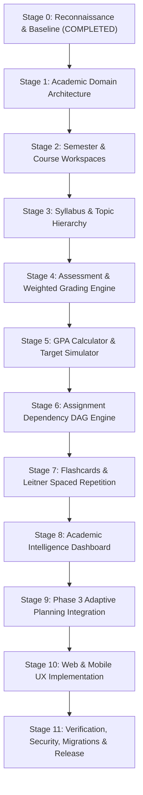

# Planrova 2.0 — Phase 4 Engineering Baseline
**Academic & Professional Workspaces**
**Author:** Principal Software Architect, Full-Stack Engineer & QA Lead  
**Date:** November 14, 2026  
**Status:** Baseline Established & Verified

---

## 1. Executive Summary & Verification State

Phase 4 of Planrova 2.0 unifies courses, syllabi, topic mastery, assessments, GPA calculation/simulation, assignment dependency graphs, and flashcards with Leitner spaced repetition into a cohesive, offline-first Academic & Professional Workspace.

Before introducing any Phase 4 code, the existing repository state was independently audited, executed, and benchmarked:
- **Automated Test Suite**: 21 passed / 21 test files (**144 / 144 tests passing**, 100% pass rate).
  - Phase 1 & 2 baseline: 15 test files (85 tests passing).
  - Phase 3 Adaptive Scheduling baseline: 6 test files (`schedulingStage2` through `schedulingStage7`, 59 tests passing).
- **Production Web Build**: `vite build` succeeded with zero errors, transforming 107 modules in ~300ms.
- **Scheduling Engine Performance**: Sub-millisecond execution (<0.35ms at 250 tasks scale).
- **Account Isolation & Sync**: Verified zero cross-tenant contamination in Dexie and Firestore.

---

## 2. Existing System Architecture

### 2.1 Web Architecture
- **Framework**: Vanilla ECMAScript 2022 (ES6 modules) bundled via Vite 8.0.
- **Client Persistence**: Dexie.js (IndexedDB) database `PlanoryLocalDB` with table `kv_store` (schema version 2: scoped `id`, `user_id`, `key`, `sync_status`, `updated_at`, `retry_count`).
- **Cloud Backend & Sync**: Firebase Authentication (v12.13) + Cloud Firestore with offline queue, exponential backoff, jitter, and deletion tombstones.
- **Styling**: Pure CSS with design tokens (`COLORS`, `TYPOGRAPHY`, `BORDER_RADIUS` in `src/utils/tokens.js`) and CSS variables.

### 2.2 Mobile Architecture
- **Framework**: React Native 0.81.5 + Expo SDK 54 (managed workflow with custom native Kotlin plugins).
- **Navigation**: React Navigation v7 (`@react-navigation/native-stack`, `@react-navigation/bottom-tabs`).
- **State & Data**: `useFirestoreData` custom hook synchronized to `/users/{userId}/appData/{key}`, matching web's storage semantics.
- **Hardware Integration**: Native Android Kotlin alarm managers, foreground notification services, and audio engines.

### 2.3 Shared Domain Layer (`shared/domain/`)
Platform-independent domain contracts with zero UI or framework dependencies:
- `shared/domain/entities/`: Canonical schemas for `Task`, `Note`, `Habit`, `Expense`, `Reminder`, and `CalendarEvent`.
- `shared/domain/relationships/`: Bidirectional referential linking (`linkedTaskIds` and `linkedNoteIds`).
- `shared/domain/capture/`: Universal quick capture engine (<5ms classifier + NLP temporal parser).
- `shared/domain/scheduling/`: Complete Adaptive Planning Engine (availability, conflict detection, deterministic scoring, greedy lookahead allocation, workload intelligence, smart buffers, and adaptive rescheduling).

---

## 3. Existing Domain Entities & Contracts

| Entity | Primary Attributes | Relationship Connections |
| :--- | :--- | :--- |
| **Task** | `id`, `title`, `description`, `status`, `completed`, `priority`, `dueDate`, `startTime`, `endTime`, `estimatedMinutes`, `allowSplit`, `scheduledSessions` | `linkedNoteIds`, `scheduledSessions` |
| **Note** | `id`, `title`, `content`, `date`, `subject`, `tags`, `pinned` | `linkedTaskIds` |
| **Habit** | `id`, `name`, `icon`, `category`, `completionDates`, `currentStreak`, `longestStreak` | Self-contained completion tracking |
| **Expense** | `id`, `amountMinor`, `amount`, `currency`, `category`, `description`, `date` | Integer minor currency units |
| **CalendarEvent** | `id`, `title`, `startDate`, `endDate`, `startTime`, `endTime`, `allDay`, `isFixed` | Fixed commitments for availability engine |
| **ScheduleBlock** | `id`, `date`, `startTime`, `endTime`, `durationMinutes`, `blockType`, `sourceEntityId`, `isFixed`, `isLocked` | Materialized intervals on timeline |
| **ScheduleProposal**| `id`, `targetDate`, `status`, `sourceSnapshotHash`, `proposedBlocks`, `unscheduledTasks`, `workload` | Immutable plan proposal with freshness hash |

---

## 4. Existing Storage & Synchronization Conventions

### 4.1 Storage Keys & Scoping
- In Dexie: `localDB.kv_store` records use `id = ${userId}:${key}` and `key = ${key}`.
- In Cloud Firestore: records map directly to `/users/{userId}/appData/{key}` with `{ value, updated_at, deleted }`.
- In Memory: `_cache` Map in `src/utils/storage.js` provides synchronous, zero-latency reads for UI components.

### 4.2 Account Switching & Tenant Isolation
- Logout immediately executes `clearMemoryCache()`, preventing in-memory session leakage.
- Preloading filters exclusively on `record.user_id === activeUser` or scoped `id.startsWith('${activeUser}:')`.
- Firestore security rules strictly mandate `request.auth.uid == userId` for `/users/{userId}/**`.

---

## 5. Existing Technical Debt & Risk Register

1. **TD-001 (Monolithic Screen Files)**: `mobile/src/screens/AlarmScreen.js` (3,500+ lines) and `mobile/src/screens/ScheduleScreen.js` (2,000+ lines). Phase 4 will avoid bloating screens by creating modular components and sub-views.
2. **TD-002 (Vite Dynamic Import Warnings)**: Static and dynamic import mixing for core singleton services.
3. **TD-007 (Historical Timetable Compatibility)**: Existing `timetable` and `semester_dates` in mobile need seamless bridging to Phase 4 `Semester` and `Course` entities without breaking users' active schedules.

---

## 6. Phase 4 Implementation Plan & Stage Roadmap



### Planned File Structure (`shared/domain/academic/`)
```text
shared/domain/academic/
├── academic.types.js            # Enums, statuses, assessment types, grading scales, Leitner intervals
├── academic.validation.js       # Schemas, normalizers, and invariants for all academic entities
├── academic.utils.js            # Grading, weighting, DAG validation, and Leitner time calculations
├── semester.schema.js           # Semester entity contracts and normalization
├── course.schema.js             # Course entity contracts, credits, instructors, color coding
├── syllabus.schema.js           # Hierarchical syllabus and topic models with mastery tracking
├── assessment.schema.js         # Weighted assessments (exams, quizzes, projects, practicals)
├── gpa.engine.js                # Semester GPA, CGPA, and target SGPA simulation calculations
├── assignment-dependency.js     # Assignment DAG, cycle detection (Tarjan/DFS), critical path
├── spaced-repetition.engine.js  # Deterministic Leitner box transitions and due queue evaluation
├── academic-progress.engine.js  # Course completion, syllabus progress, and attention indicators
└── index.js                     # Unified domain public exports
```

---

## 7. Migration & Compatibility Strategy

1. **Historical Timetable & Semester Events**:
   - Existing records under `timetable` and `semester_events` in Firestore/Dexie will continue to be recognized and can optionally populate initial courses and assessments.
2. **Task Integration**:
   - Assignments will create or reference canonical `Task` records. Task completion will bidirectionally update assignment progress.
3. **Phase 3 Scheduler Integration**:
   - Examination dates, assignment subtasks, and flashcard review queues will feed into `generateScheduleProposal` as fixed commitments or flexible tasks without creating competing scheduling engines.
4. **Offline & Multi-Tenant Safety**:
   - All academic collections will be user-scoped, supporting soft-deletion tombstones and idempotent synchronization.

