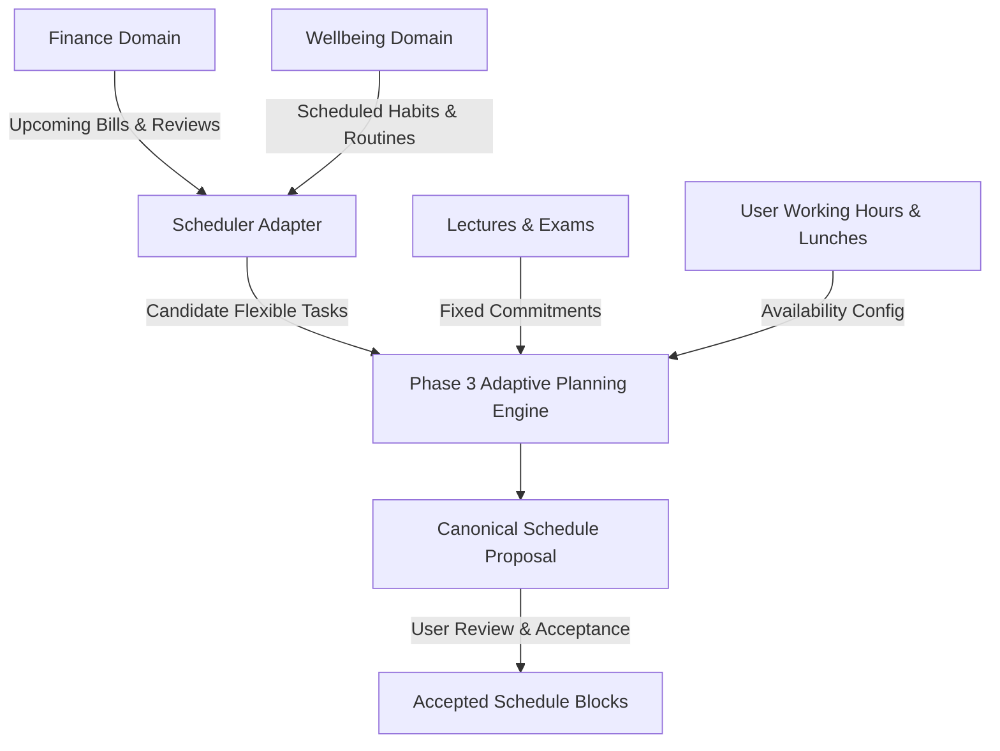

# Phase 5 Adaptive Planning Integration Architecture

## 1. Overview
Phase 5 integrates Personal Finance and Personal Wellbeing into Planrova's unified Adaptive Planning Engine (`shared/domain/scheduling/`).

**Single Engine Rule:** Zero secondary schedulers were created. All financial obligations, habits, and routines generate candidate inputs for Phase 3's `generateScheduleProposal`.

---

## 2. Transformation Pipeline

---

## 3. Guarantees & Safeguards
1. **Zero Collision with Fixed Commitments:** Financial tasks, habits, and routines never overlap with fixed lectures, exams, or pre-exam buffer blocks.
2. **Locked Blocks Preserved:** Manually locked blocks are never moved or overwritten.
3. **Freshness Invalidation:** Changes to recurring bills, subscriptions, habits, or routines invalidate stale proposals via the `sourceSnapshotHash`.
4. **User-Approved Acceptance:** Schedule proposals require explicit user confirmation before writing `schedule_blocks`.

