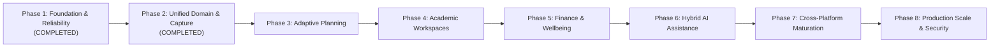

# Planrova 2.0 — Engineering Roadmap

---

## Phase 1: Foundation and Reliability (Completed)
- **Status:** **DONE**
- **Objectives:**
  - [x] Audit and inventory existing web, mobile, server, and database codebases.
  - [x] Implement durable offline synchronization queue with exponential backoff and jitter.
  - [x] Eliminate record resurrection using deletion tombstones for collections.
  - [x] Fix cross-account data leakage in IndexedDB on account switching.
  - [x] Standardize monetary calculations using integer minor units.
  - [x] Provide timezone-safe date parsing to eliminate UTC midnight day shifts.
  - [x] Establish Vitest unit & integration test suites.
  - [x] Create CI/CD workflow running test, build, and quality gates.
  - [x] Provide strict Firestore security rules and backend proxy rate limiting.

---

## Phase 2: Unified Domain and Capture (Completed)
- **Status:** **DONE**
- **Focus:** Ubiquitous input capture & shared canonical domain abstractions.
- **Objectives:**
  - [x] Shared canonical domain models and normalizers (`Task`, `Note`, `Habit`, `Expense`, `Reminder`, `CalendarEvent`).
  - [x] Universal Quick-Capture engine (<5ms local-first classifier + temporal parser).
  - [x] Web Quick Capture floating action button (`#quick-capture-fab`), modal dialog, and `Ctrl+Q` global shortcut.
  - [x] Mobile React Native `QuickCaptureModal` integrated into primary Tab Navigator and Capture screen.
  - [x] Bidirectional Note-to-Task linking with symmetric referencing and soft-deletion cascade protection.
  - [x] Unified Habit schema aligning Web `streak` with Mobile `fire` via canonical `completionDates`.
  - [x] Firestore security rules hardening (Study Room ownership protection and message authorship immutability).
  - [x] 100% test pass rate across 15 test suites and 85 automated tests.

---

## Phase 3: Adaptive Planning
- **Focus:** Dynamic scheduling & workload intelligence.
- **Milestones:**
  - Conflict detection engine for overlapping lecture and study blocks.
  - Cognitive workload scoring (estimating mental fatigue per day).
  - Smart buffer recommendation before exam dates and assignment deadlines.
  - Automatic task rescheduling when items are missed.

---

## Phase 4: Academic and Professional Workspaces
- **Focus:** Multi-course management & exam readiness.
- **Milestones:**
  - Course workspaces with syllabus outlines, grading weights, and instructor contact cards.
  - Semester GPA calculator and academic target simulator.
  - Flashcard generator with Leitner spaced repetition interval scheduler.
  - Assignment dependency trees (research &rarr; outline &rarr; draft &rarr; peer review).

---

## Phase 5: Finance and Wellbeing
- **Focus:** Comprehensive personal resource tracking.
- **Milestones:**
  - Multi-wallet expense tracking (Cash, UPI, Bank Account).
  - Recurring student subscription audit (Spotify, GitHub, Netflix, Gym).
  - Sleep tracking integration with AlarmActivity wake-up statistics.
  - Screen-time and digital detox wind-down timer routines.

---

## Phase 6: Hybrid AI Assistance
- **Focus:** On-device privacy combined with cloud synthesis.
- **Milestones:**
  - On-device local LLM execution (WebGPU / ONNX Runtime) for zero-latency NLP task parsing.
  - Groq-powered weekly retrospective synthesis ("Week in Review" auto-summaries).
  - Autonomous syllabus ingestion: uploading PDF syllabi automatically populates the semester timetable.

---

## Phase 7: Cross-Platform Improvements
- **Focus:** Native device parity & ecosystem cohesion.
- **Milestones:**
  - Android Home Screen interactive widgets (Jetpack Compose / React Native Widget extension).
  - macOS & Windows desktop packaging via Electron or Tauri.
  - Full bidirectional offline synchronization between Mobile SQLite and Web IndexedDB.

---

## Phase 8: Production Readiness & Enterprise Security
- **Focus:** Scale, compliance, and multi-region availability.
- **Milestones:**
  - End-to-End Encryption (E2EE) for private notes using Web Crypto API.
  - Automated database backup snapshots and point-in-time recovery.
  - Penetration testing, SOC2 compliance preparation, and comprehensive telemetry.
