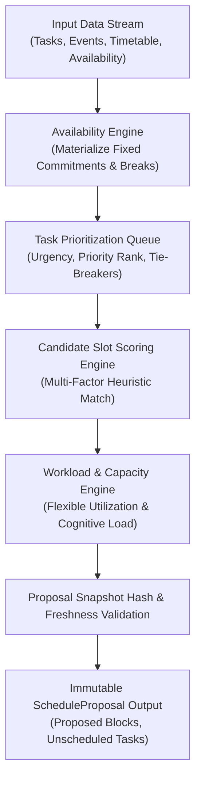

# Planrova 2.0 — Adaptive Scheduling Engine

**Author:** Principal Software Architect & Scheduling Algorithm Engineer  
**Date:** 2026-11-14  
**Document:** `docs/SCHEDULING_ENGINE.md`

---

## 1. Executive Summary

The Planrova 2.0 Adaptive Scheduling Engine (`shared/domain/scheduling/`) is a deterministic, explainable, multi-pass greedy heuristic scheduling algorithm that runs locally on Web and Mobile devices with zero external cloud or LLM dependencies. It allocates flexible tasks into optimal candidate time windows around fixed commitments (lectures, exams, locked blocks, and breaks) in sub-millisecond execution times.

---

## 2. Architectural Pipeline

---

## 3. Availability & Calendar Engine

The Availability Engine (`availability.engine.js`) constructs daily working intervals:
1. **Materialization of Timetable Entries:** Recurring class periods and lab blocks are expanded into fixed calendar events for each day of the scheduling horizon.
2. **Fixed Commitment Subtraction:** Any immovable calendar event (lecture, meeting, doctor appointment) is subtracted from the user's configured working hours.
3. **Reserved Break Allocation:** Dedicated lunch and dinner windows (e.g. 12:30–13:30, 19:30–20:30) are pre-allocated as unavailable time blocks.
4. **Free Interval Extraction:** The remaining contiguous windows represent available candidate slots for flexible task scheduling.

---

## 4. Candidate Slot Suitability Scoring

For each candidate time slot, the engine evaluates suitability using normalized multi-factor scoring (Total = 100 points):

$$\text{SuitabilityScore} = S_{\text{focus}} + S_{\text{contiguity}} + S_{\text{proximity}} + S_{\text{earliness}} - P_{\text{fragmentation}}$$

| Component | Weight | Scoring Logic |
| :--- | :---: | :--- |
| **Preferred Focus Match ($S_{\text{focus}}$)** | **40 pts** | Matches task tag/category with time-of-day preference (e.g. deep focus coding in morning, light administrative work in late afternoon). |
| **Contiguity Bonus ($S_{\text{contiguity}}$)** | **30 pts** | Rewards placing tasks adjacent to existing work sessions of similar context, minimizing context-switching penalties. |
| **Buffer Proximity ($S_{\text{proximity}}$)** | **20 pts** | Ensures adequate transition buffers (minimum 10 minutes) around exams and high-cognitive commitments. |
| **Earliness Preference ($S_{\text{earliness}}$)** | **10 pts** | Slight linear preference for earlier slots in the day to prevent procrastination drift. |
| **Fragmentation Penalty ($P_{\text{fragmentation}}$)** | **Up to -25 pts** | Penalizes leaving useless micro-gaps ($<15$ mins) between scheduled blocks. |

---

## 5. Workload Modeling & Flexible Capacity Utilization

The workload engine (`workload.model.js`) evaluates whether a user's day is realistically achievable:

### 5.1 Flexible Capacity Formula
$$\text{FlexibleCapacity} = \text{AvailableWorkingMinutes} - \text{FixedCommitmentMinutes} - \text{ReservedBreakMinutes}$$

### 5.2 Utilization Ratio
$$\text{Utilization} = \frac{\text{ScheduledFlexibleMinutes}}{\text{FlexibleCapacity}}$$

### 5.3 Workload Classification Thresholds
- **Underutilized ($\text{Utilization} < 0.60$):** Capacity remains to schedule additional backlog tasks.
- **Balanced ($0.60 \le \text{Utilization} \le 0.85$):** Ideal working cadence with healthy cognitive breathing room.
- **Heavy ($0.85 < \text{Utilization} \le 1.00$):** Full day; high focus required; warning emitted against adding extra commitments.
- **Overloaded ($\text{Utilization} > 1.00$):** Infeasible schedule. Tasks exceeding capacity are displaced to the unscheduled backlog with an explanation.

---

## 6. Split-Task Persistence & Rescheduling

Long tasks (e.g. 180-minute term paper preparation) frequently cannot fit into a single contiguous open slot:
1. **Decomposition:** Long tasks are split into linked sub-blocks (`splitSourceTaskId`, `splitIndex`, `totalSplits`).
2. **Sequential Placement:** Split blocks are placed sequentially across candidate slots, preserving minimum block duration thresholds ($\ge 30$ mins).
3. **Rescheduling:** If a user completes, reschedules, or deletes a sub-block, sibling blocks adjust dynamically while preserving the parent deliverable's total scheduled time.

---

## 7. Proposal Versioning & Snapshot Freshness

To prevent accepting stale proposals computed against out-of-date calendar state:
1. **Deterministic Input Snapshot:** All scheduling inputs (active tasks, calendar events, availability hours, preferences) are serialized into a canonical representation.
2. **Snapshot Hashing:** Generates a deterministic hash string (`snapshotHash`).
3. **Pre-Acceptance Freshness Check:** When the user clicks "Accept Proposal", the engine recalculates the live input hash. If any input has changed, the proposal is flagged as stale and recomputed before committing mutations.
