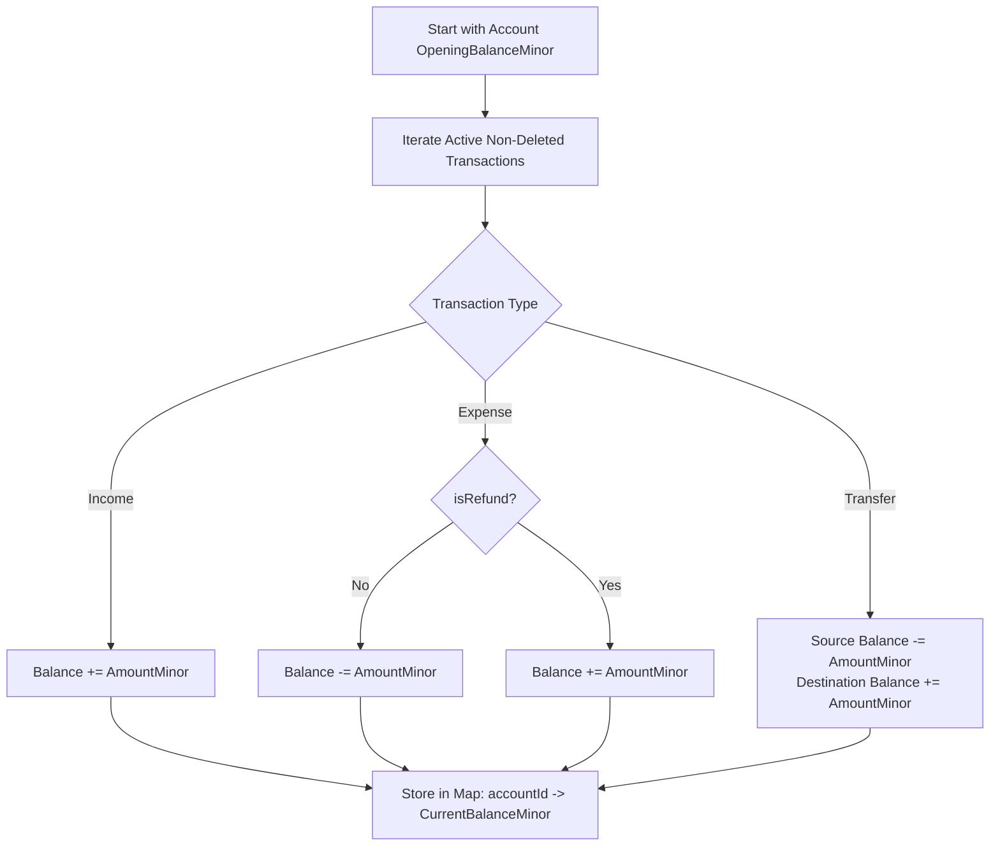

# Transaction Management & Balance Reconciliation Engine

## 1. Overview
The Transaction Management Engine (`shared/domain/finance/transaction.engine.js`) is responsible for managing transactions, reconciling account balances, enforcing double-entry transfer invariants, handling refunds, and querying financial history.

---

## 2. Balance Reconciliation Algorithm

Account balances are reconciled using a deterministic pure function `reconcileAccountBalances(accounts, transactions)`:

### Pure Mathematical Formula
$$\text{AccountBalance}(a) = \text{OpeningBalance}(a) + \sum_{t \in \text{Income}(a)} A(t) - \sum_{t \in \text{Expense}(a, \neg \text{refund})} A(t) + \sum_{t \in \text{Refund}(a)} A(t) + \sum_{t \in \text{TransferTo}(a)} A(t) - \sum_{t \in \text{TransferFrom}(a)} A(t)$$

---

## 3. Idempotency & Duplicate Detection

Accidental double-click or network re-try submissions are intercepted using `isDuplicateTransaction`:
1. **Explicit Idempotency Key:** If candidate has `idempotencyKey`, any existing transaction matching the key flags as duplicate.
2. **Signature Matching:** Compares `(accountId, transactionDate, amountMinor, type, title.toLowerCase())`. If an identical active transaction exists, duplicate creation is prevented.

---

## 4. Query, Search & Sorting
`queryTransactions(transactions, options)` provides in-memory indexed filtering:
- Category filtering (`categoryId`)
- Account filtering (`accountId` as source or destination)
- Date range (`startDate` to `endDate`)
- Full-text search across `title`, `description`, and `notes`
- Tag matching
- Deterministic sorting by `date` or `amount` in ascending or descending order.

